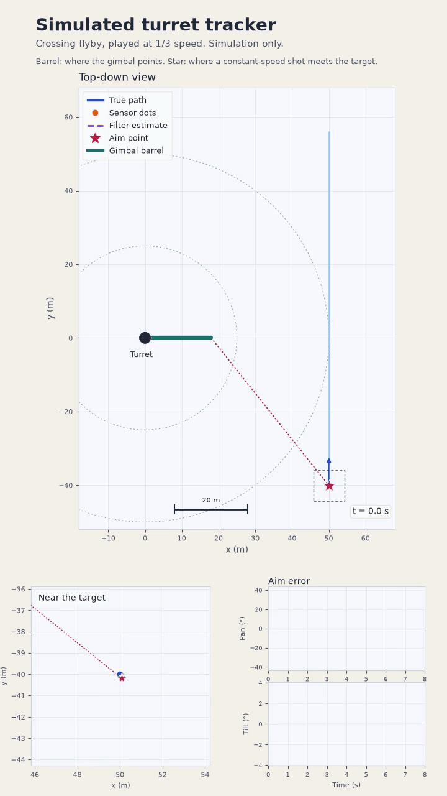
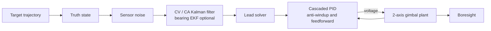
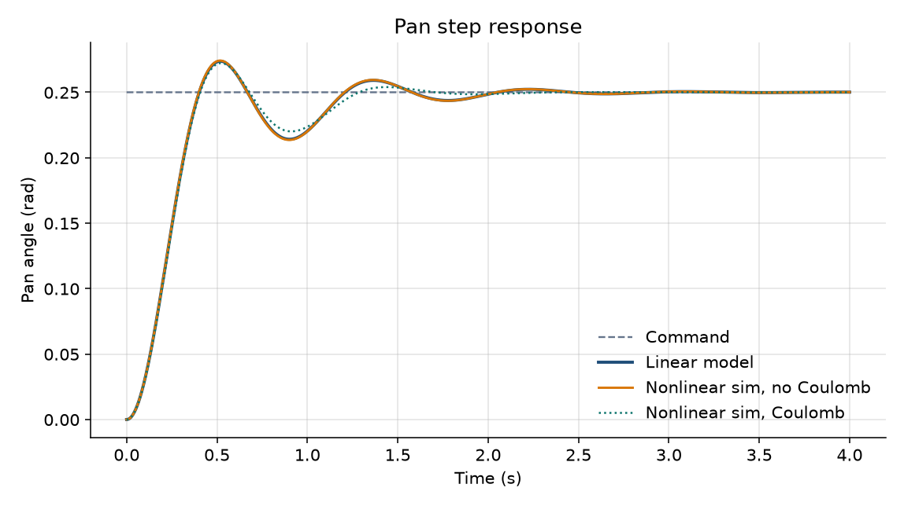
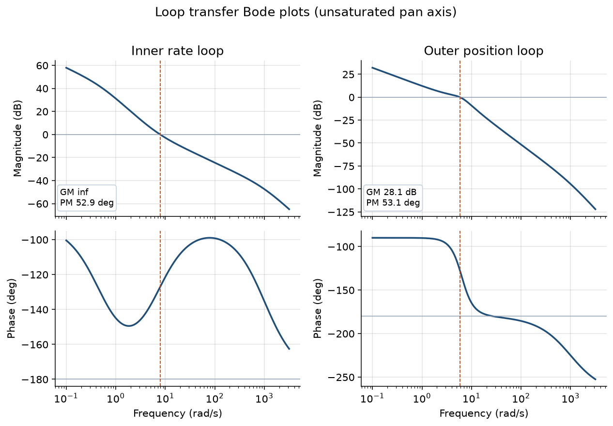
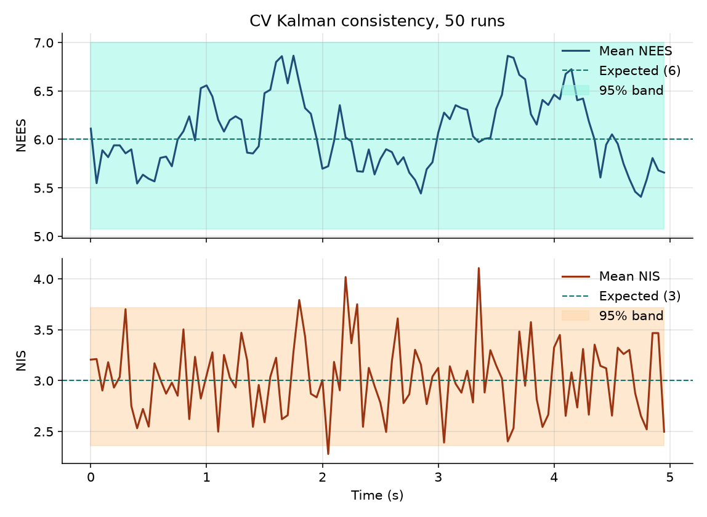
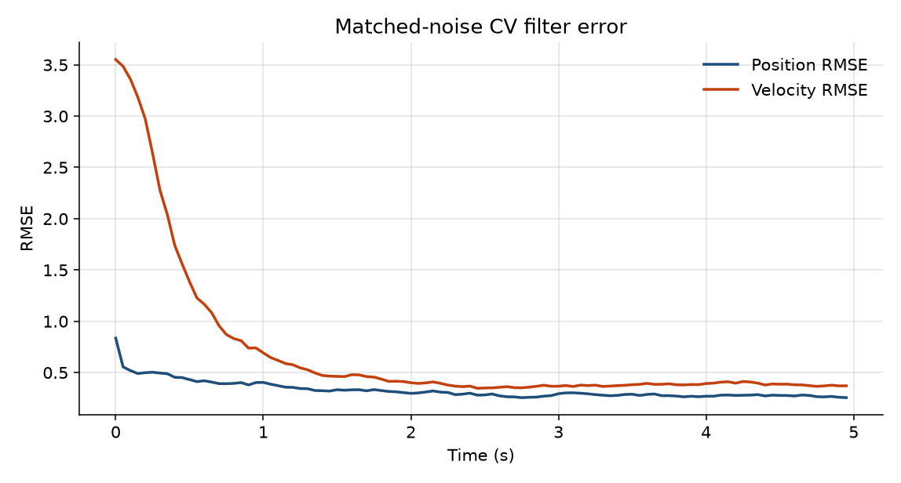
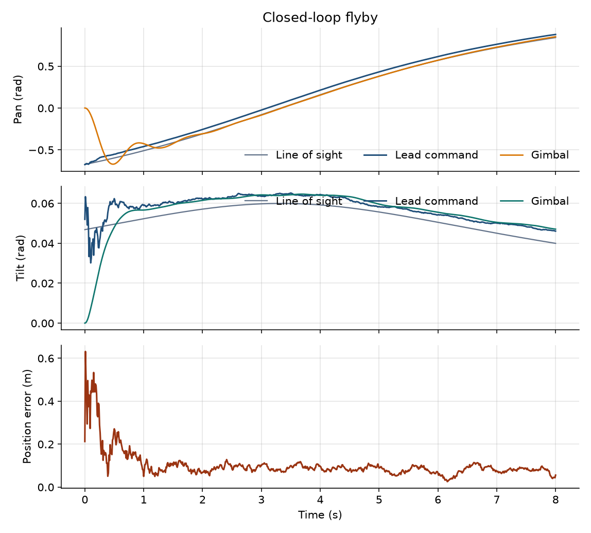

# Gimbal tracker

[](https://github.com/gambrelcolby63/gimbal-tracker-ros2/actions/workflows/ci.yml)



The portrait clip is the shipped flyby, slowed to one-third speed so the motion is easy to follow. It is a picture of the simulator: no weapon, seeker, or platform.

A simulated two-axis gimbal that estimates a moving target and points at the intercept of a constant-speed projectile. The control, estimation, and lead math live in a ROS-free C++17 library. A ROS 2 Humble package is a thin wrapper around that library.

This is a closed-loop controls exercise: a motor model, cascaded PID, a Kalman filter, and vacuum kinematics. There is no weapon, fuze, seeker hardware, or platform integration. The "projectile" is a point mass with a speed you set in YAML.

## Problem

A turret at the origin has to keep a pan/tilt gimbal on a target it cannot measure cleanly.

1. A trajectory generator flies the target (constant velocity, constant acceleration, or a horizontal circle).
2. A sensor adds noise, either in Cartesian position or in azimuth, elevation, and range.
3. A constant-velocity or constant-acceleration Kalman filter estimates the target. Bearing/range measurements use an EKF update.
4. A lead solver finds the launch direction whose projectile meets the target. Gravity is optional and, when enabled, is vacuum drop only.
5. Cascaded position and rate loops drive each gimbal axis. The plant includes motor electrical dynamics, inertia, viscous and Coulomb friction, and voltage, torque, and rate limits.



The two axes are independent. That is the usual model for a mass-balanced gimbal: no inertial coupling, and no gravity torque on the axes themselves. Pan wraps. Tilt stops at mechanical limits.

## Repository layout

| Path | What it is |
| --- | --- |
| `include/gimbal_tracker/`, `src/` | C++17 library. No ROS headers. |
| `config/gimbal_tracker.yaml` | Plant, gains, filter, lead, and trajectory tuning. |
| `tests/` | GoogleTest for the controller, Kalman filter, and lead solver. |
| `apps/` | Step response, Monte Carlo consistency, and closed-loop flyby. |
| `scripts/` | Bode / step metrics (`python-control`), NEES / RMSE plots, and the flyby animation. |
| `docs/` | Generated plots, metric JSON, and `docs/demo/` (MP4 and GIF). |
| `ros2_ws/` | Humble messages, five nodes, launch file, RViz config. |
| `Dockerfile`, `.devcontainer/` | Humble dev container for local use or Codespaces. |

## Gimbal plant

Each axis is a DC motor on a rigid inertia. State is angle, rate, and current:

\[
L \dot i = v - R i - K_b \omega, \qquad
J \dot\omega = \mathrm{sat}\big(K_t i - b\omega - \tau_c \tanh(\omega / \omega_s)\big), \qquad
\dot\theta = \omega
\]

Voltage, torque, and rate are saturated. The electrical pole \(R/L\) is near 1000 rad/s, so the integrator substeps inside each control period. `measure()` adds encoder and gyro noise; the integrated state stays clean. Shipped parameters are in `config/gimbal_tracker.yaml` (pan inertia 0.05 kg·m², tilt 0.04 kg·m², 24 V bus).

## Cascaded controller

Position is an outer P loop. Rate is an inner PI loop. Feedforward adds the commanded rate and, on the voltage, a back-EMF / viscous term plus an acceleration term:

\[
\omega_\mathrm{cmd} = \mathrm{sat}\big(K_{p,\theta}\, e_\theta + K_{\mathrm{ff},\theta}\, \omega_\mathrm{ff}\big)
\]
\[
v = \mathrm{sat}\big(K_{p,\omega}\, e_\omega + \xi + K_{\mathrm{ff},\omega}\, \omega_\mathrm{cmd} + K_{a,\omega}\, \alpha_\mathrm{ff}\big)
\]

Pan angle error is wrapped to \((-\pi, \pi]\). The integrator state \(\xi\) uses back-calculation so a saturated voltage does not wind up:

\[
\dot\xi = K_{i,\omega}\, e_\omega + K_\mathrm{aw}\,(v - v_\mathrm{unsat})
\]

`rate_kff` is set to \(K_b + b R / K_t\) and `rate_kaff` to \(J R / K_t\), which is the steady voltage for a commanded rate and the inertial voltage for a commanded acceleration. Position \(k_\mathrm{ff} = 1\) passes the reference rate straight through, so a ramp does not need a constant position lag to produce that rate.

## Kalman filter

### Constant velocity

State \(\mathbf{x} = [p^\top, v^\top]^\top\) in the turret frame. Over a step \(\Delta t\) the mean motion is

\[
F = \begin{bmatrix} I & \Delta t\, I \\ 0 & I \end{bmatrix}
\]

Process noise is piecewise-constant white acceleration, independent on each axis, with standard deviation \(\sigma_a\):

\[
Q_i = \sigma_a^2
\begin{bmatrix}
\Delta t^4 / 4 & \Delta t^3 / 2 \\
\Delta t^3 / 2 & \Delta t^2
\end{bmatrix}
\]

The Monte Carlo truth uses that same draw, \(a \sim \mathcal{N}(0, \sigma_a^2)\), held over the step. That is what makes the NEES check meaningful.

### Constant acceleration

State appends acceleration. Process noise is piecewise-constant jerk with standard deviation \(\sigma_j\). The discrete input vector on one axis is

\[
G = \begin{bmatrix} \Delta t^3 / 6 & \Delta t^2 / 2 & \Delta t \end{bmatrix}^\top, \qquad Q_i = \sigma_j^2\, G G^\top
\]

### Update

Cartesian measurements use \(H = [I\ 0]\). The covariance update is the Joseph form

\[
P^+ = (I - KH)\, P\, (I - KH)^\top + K R K^\top
\]

so \(P\) stays symmetric when \(R\) does. Normalized estimation error squared and normalized innovation squared are

\[
\mathrm{NEES} = \tilde{\mathbf{x}}^\top P^{-1} \tilde{\mathbf{x}}, \qquad
\mathrm{NIS} = \mathbf{y}^\top S^{-1} \mathbf{y}
\]

For a consistent linear filter the average NEES sits near the state dimension (6 for CV, 9 for CA) and the average NIS near 3.

### Bearing / range EKF

The nonlinear measurement is azimuth, elevation, and range:

\[
h(p) = \begin{bmatrix} \operatorname{atan2}(y, x) \\ \operatorname{atan2}(z, \sqrt{x^2+y^2}) \\ \|p\| \end{bmatrix}
\]

The update linearizes \(h\) at the predicted state. The azimuth innovation is wrapped to \((-\pi, \pi]\) so a target crossing the negative x-axis does not look like a \(2\pi\) jump. On the boresight axis, where azimuth is undefined, that row is dropped.

## Lead solver

The projectile leaves the muzzle at constant speed \(s\). With no drag and no gravity, the intercept time is the smallest positive root of

\[
\| \mathbf{r} + \mathbf{v} t \| = s t
\]

which is the quadratic \(a t^2 + b t + c = 0\) with

\[
a = \|\mathbf{v}\|^2 - s^2, \quad b = 2\, \mathbf{r}\cdot\mathbf{v}, \quad c = \|\mathbf{r}\|^2
\]

\(\mathbf{r}\) is the target position relative to the muzzle. If the target is faster than the projectile and is not closing, there is no positive root and the solver says so. A target with acceleration is iterated: predict the position at the candidate time, then set the next time to range over \(s\).

With gravity \(g > 0\) the shot is a vacuum parabola. For a predicted intercept at horizontal range \(R\) and height \(z\), elevation \(\theta\) solves

\[
z = R \tan\theta - \frac{g R^2}{2 s^2 \cos^2\theta}
\]

Let \(u = \tan\theta\) and \(c = g R^2 / (2 s^2)\). Then

\[
c u^2 - R u + (z + c) = 0
\]

The smaller positive time of flight is kept (the low trajectory). Because the target is moving, that elevation is wrapped in a fixed-point iteration on the intercept time. The shipped config uses \(s = 220\,\mathrm{m/s}\) and \(g = 9.80665\,\mathrm{m/s}^2\). Set `gravity_m_s2` to 0 for a pure straight-line lead.

## Results

Regenerated by `scripts/run_analysis.sh` from the shipped YAML. The pan step is 0.25 rad. Margins are for the unsaturated linearization (Coulomb friction removed). The nonlinear simulation and that linear model differ by **0.00024 rad RMS**.

| | No Coulomb | With Coulomb | Linear model |
| --- | ---: | ---: | ---: |
| Rise time, 10–90% | 0.261 s | 0.266 s | 0.262 s |
| Overshoot | 9.7% | 8.9% | 9.5% |
| Settling, 2% band | 1.88 s | 1.22 s | 1.88 s |
| Steady-state error | \(4.5\times 10^{-5}\) rad | \(\sim 0\) | \(4.7\times 10^{-5}\) rad |

| Loop | Gain margin | Phase margin | Gain crossover |
| --- | ---: | ---: | ---: |
| Inner rate | no phase crossover | 52.9° | 7.85 rad/s |
| Outer position | 28.1 dB | 53.1° | 5.78 rad/s |





The rate loop's phase approaches −180° from above inside the plotted band and never crosses it, so the linear gain margin is unbounded. The outer loop is the one that sets the stability limit, at about 26 rad/s.

The consistency run is 50 Monte Carlo trials of the CV filter with the process noise the filter assumes. Mean NEES is **6.07** (state dimension 6) and mean NIS is **3.02** (measurement dimension 3). Every time sample of the averaged NEES sits inside the 95% chi-squared band for 50 runs, \([5.08, 7.00]\). Final RMSE is **0.25 m** and **0.37 m/s**.





The flyby is the shipped target: it starts at \((50, -40, 3)\,\mathrm{m}\) and crosses in front of the turret at 12 m/s. After the one-second acquisition, pan tracking error is **0.050 rad RMS** and tilt error is **0.0011 rad RMS**. Every lead solution on that pass is valid. Mean estimated position error after one second is **0.083 m**. The command sits about **0.049 rad** ahead of the line of sight in azimuth, and gravity adds about **0.0046 rad** of super-elevation.



## How to run

Dependencies for the library: CMake, a C++17 compiler, Eigen3, yaml-cpp. Analysis also wants Python 3 with the packages in `requirements.txt` (`numpy`, `scipy`, `matplotlib`, `PyYAML`, `control`).

```bash
cmake -S . -B build -DCMAKE_BUILD_TYPE=Release
cmake --build build -j
ctest --test-dir build --output-on-failure
python3 -m venv .venv && . .venv/bin/activate && pip install -r requirements.txt
PYTHON=python BUILD_DIR="$PWD/build" bash scripts/run_analysis.sh
```

The phone-friendly flyby above is regenerated with the same library and YAML. It needs `ffmpeg` as well as the Python packages:

```bash
PYTHON=python BUILD_DIR="$PWD/build" bash scripts/make_flyby_demo.sh
```

That writes `docs/demo/flyby.mp4` and `docs/demo/flyby.gif` (about 24 seconds, portrait).

`ctest` covers the cascaded loop (step specs, wrap, rate saturation, anti-windup, ramp feedforward), the CV and CA filters (scalar update, process-noise \(Q\), NEES/NIS, bearing Jacobian, azimuth branch cut), and the lead solver (closed-form intercepts, unreachable targets, vacuum drop).

### ROS 2 Humble

```bash
source /opt/ros/humble/setup.bash
cd ros2_ws
colcon build --symlink-install
source install/setup.bash
ros2 launch gimbal_tracker_ros gimbal_tracker.launch.py rviz:=true
```

`rviz:=false` is the default, so the same launch works over SSH. Switch the sensor with `measurement:=bearing_range`. The launch file reads `config/gimbal_tracker.yaml` from the package share directory; pass `config:=/path/to/gimbal_tracker.yaml` to try a different tune without reinstalling.

| Topic | Message | Role |
| --- | --- | --- |
| `/target/truth` | `TargetTruth` | Noise-free target from `target_sim_node` |
| `/sensor/measurement` | `SensorMeasurement` | Cartesian or bearing/range |
| `/target/estimate` | `TargetEstimate` | Filter mean, 6×6 covariance, NIS |
| `/gimbal/state` | `GimbalState` | Noisy encoder and gyro |
| `/gimbal/truth` | `GimbalState` | Integrated plant state |
| `/gimbal/command` | `GimbalCommand` | Pan and tilt voltage |
| `/gimbal/setpoint` | `TrackSetpoint` | Lead angles, time of flight, intercept |

Frames are `map` → `turret` → `boresight` and `turret` → `target`. RViz also shows the target sphere, the boresight arrow, and the lead line.

### Docker and Codespaces

`Dockerfile` is `ros:humble-ros-base` plus the C++ and Python dependencies. The devcontainer builds the library, runs `ctest`, and `colcon build`s the workspace on first open.

```bash
docker build -t gimbal-tracker .
docker run --rm -it -v "$PWD":/workspace gimbal-tracker bash
```

RViz needs a display forwarded into the container. The library tests and the analysis scripts do not.

## Tuning

All of the numbers above come from `config/gimbal_tracker.yaml`. The loops were shaped so the inner crossover (7.9 rad/s) sits above the outer one (5.8 rad/s) with about 53° of phase margin on both. Coulomb friction is small next to the available torque; it trims overshoot and shortens the 2% settling time. To retune, edit the YAML and rerun `scripts/run_analysis.sh`. The unit test `Controller.ShippedYamlTuningSettlesWithFriction` fails if that file no longer settles a 0.25 rad step.

## What I learned

Replace the prompts below with your own notes before using this as an application piece.

- **Plant versus model:** Where did friction or the voltage limit show up once the linear Bode plot was no longer the whole story?
- **Loop shaping:** The shipped margins are about 53°. What broke when the rate loop was slowed toward the position loop?
- **Estimator consistency:** Mean NEES landed on 6.07. Which noise term would you change if a real sensor ran hot or cold?
- **Lead geometry:** When did the solver report no intercept, and how much did gravity move the elevation command on a slower projectile?
- **ROS boundary:** What belonged in the C++ library, and what did the nodes only route?

## License

MIT. See [LICENSE](LICENSE).
